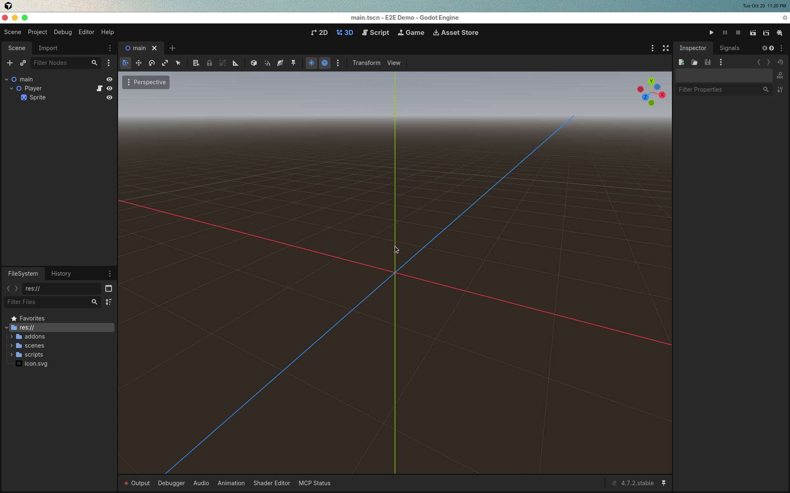
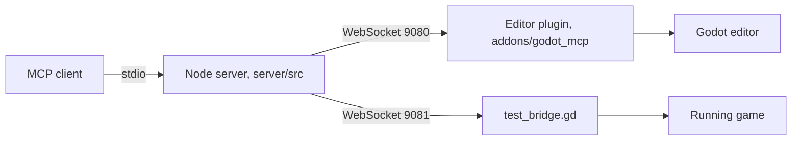

# godot-mcp

[](https://github.com/sc-lacanlale/godot-mcp/actions/workflows/ci.yml)
[](https://www.npmjs.com/package/@xianlee/godot-mcp)

MCP server and Godot 4 editor plugin. An MCP client talks to a Node process over stdio. That process edits a project through a WebSocket plugin inside the Godot editor, and it can also talk to a bridge script inside a running game.

Published on npm as [`@xianlee/godot-mcp`](https://www.npmjs.com/package/@xianlee/godot-mcp).

## Demo

Godot 4.7.2 after `scripts/e2e-godot.mjs` created `scenes/main.tscn`. The scene root is a Node2D named `main`. `Player` has `scripts/player.gd` attached, and `Sprite` is a Sprite2D.



## Architecture



Headless operations (creating a scene file, reading the project) run `godot --headless --script` against `server/src/scripts/godot_operations.gd` and do not need the editor. Live node edits need the plugin. Input and scene queries against a playing game need `test_bridge.gd` installed as an autoload named `TestBridge`.

## Requirements

- Node.js 20 or newer. FastMCP 4 depends on packages that declare this.
- Godot 4.3 or newer on `PATH`, or `GODOT_PATH` pointing at the executable. The editor plugin and the headless script were loaded with Godot 4.7.2.
- An MCP client that speaks stdio. Claude Desktop and Cursor are the two configs below.

## Install the editor plugin

From the root of a Godot project:

```bash
npx -y @xianlee/godot-mcp install
```

That copies `addons/godot_mcp` into the project. In Godot, open **Project > Project Settings > Plugins** and enable **Godot MCP**. The plugin listens on port 9080, then 9081 through 9084 if 9080 is taken.

Optional config file, copied from [`godot-mcp.config.example.json`](godot-mcp.config.example.json) to `godot-mcp.config.json` next to the project or in the directory you launch the server from:

```json
{
  "godotPath": "/absolute/path/to/godot",
  "godotProjectPath": "/absolute/path/to/the/godot/project"
}
```

The same values can be set as `GODOT_PATH` and `GODOT_PROJECT_PATH`.

## Claude Desktop

Edit the Claude Desktop config:

- macOS: `~/Library/Application Support/Claude/claude_desktop_config.json`
- Windows: `%APPDATA%\Claude\claude_desktop_config.json`
- Linux: `~/.config/Claude/claude_desktop_config.json`

```json
{
  "mcpServers": {
    "godot-mcp": {
      "command": "npx",
      "args": ["-y", "@xianlee/godot-mcp"],
      "env": {
        "GODOT_PATH": "/absolute/path/to/godot",
        "GODOT_PROJECT_PATH": "/absolute/path/to/the/godot/project"
      }
    }
  }
}
```

Restart Claude Desktop. Open the Godot project with the plugin enabled before asking for live editor edits.

## Cursor

Put the same `mcpServers` object in `~/.cursor/mcp.json`, or in `.cursor/mcp.json` inside the Godot project. Restart Cursor, or reload MCP servers from the MCP settings page.

## Tools

| Tool                      | What it does                                                                                            |
| ------------------------- | ------------------------------------------------------------------------------------------------------- |
| `manage_project`          | Launch the editor, run the project, stop it, list projects, read project info. Headless.                |
| `manage_project_config`   | Read and write `project.godot` settings and the input map.                                              |
| `manage_asset`            | Load a sprite texture, export a `MeshLibrary`, read or update UIDs.                                     |
| `manage_script`           | Create, read, edit, and attach GDScript files.                                                          |
| `manage_scene`            | Create, open, save, and inspect scenes and resources.                                                   |
| `manage_node`             | Create, delete, duplicate, list, and edit nodes in the open scene.                                      |
| `manage_physics`          | Add bodies, shapes, layers, and areas.                                                                  |
| `manage_animation`        | Add an `AnimationPlayer` and keyframes.                                                                 |
| `manage_ui`               | Add `Control` nodes, theme overrides, and layout containers.                                            |
| `manage_audio`            | Read and edit audio buses.                                                                              |
| `manage_signal`           | List, connect, and disconnect signals.                                                                  |
| `execute_editor_script`   | Run a GDScript snippet inside the editor.                                                               |
| `godot_docs`              | Search documentation files, read a class page, or fetch a bundled best-practice note.                   |
| `capture_vision`          | Capture the editor viewport, a scene preview, or a running game.                                        |
| `inspect_project`         | Read the input map, collision layers, class properties, and the editor console.                         |
| `visualize_project`       | Map scripts or scenes and open a local page with the result.                                            |
| `debug_project`           | Run a scene and collect structured errors.                                                              |
| `validate_scene`          | Check a `.tscn` or `.tres` file, and optionally rewrite fixable issues.                                 |
| `run_and_verify`          | Run the project and return a structured error report.                                                   |
| `get_project_diagnostics` | Check scripts in the project without launching a game.                                                  |
| `search_project`          | Find files by name or pattern, or read a file.                                                          |
| `semantic_search`         | Embed project scripts with `Xenova/all-MiniLM-L6-v2` and search them. The model downloads on first use. |
| `get_project_assets`      | List scenes, scripts, textures, audio, and resources.                                                   |
| `get_project_context`     | Summarize a scene file: nodes, instances, and UI.                                                       |
| `manage_game_bridge`      | Install, connect, disconnect, or ping `test_bridge.gd`.                                                 |
| `game_scene`              | Read the scene tree of the running game.                                                                |
| `game_input`              | Send key, mouse, and text input to the running game.                                                    |
| `game_state`              | Read an autoload, evaluate an expression, or read performance and viewport info.                        |
| `game_wait`               | Wait until a node exists, a property matches, a signal fires, or an expression is true.                 |

`READ_ONLY_MODE=true` omits tools registered as writers. The server also exposes four prompts (`godot_expert`, `debug_godot_project`, `create_game_feature`, `create_game_level`) and resources under the `godot/` URI scheme for scenes, scripts, project files, and editor state.

## Development

```bash
git clone https://github.com/sc-lacanlale/godot-mcp.git
cd godot-mcp
npm install
npm test
npm run build
npm start
```

`npm install` builds `server/dist` through the `prepare` script. `npm start` is the same process `npx @xianlee/godot-mcp` runs. Logs go to stderr. stdout is reserved for MCP JSON-RPC.

| Script                 | Purpose                                                     |
| ---------------------- | ----------------------------------------------------------- |
| `npm test`             | Vitest unit tests                                           |
| `npm run typecheck`    | `tsc` on the server and the tests                           |
| `npm run lint`         | ESLint                                                      |
| `npm run format:check` | Prettier                                                    |
| `npm run smoke`        | Start the built server and call `tools/list`                |
| `npm run test:e2e`     | Editor integration test. Exits 0 if Godot is not installed. |

The unit tests cover the parameter normalizer, path checks and project detection, the Godot output parser, the tool registry, and the 4.4 version check. They do not launch Godot. `npm run test:e2e` does: it creates a temporary project, enables the addon, starts the editor, and calls the tools. Set `GODOT_PATH` to the executable. Without `GODOT_PATH` or a `godot` binary on `PATH`, the script prints a skip line and exits 0. `GODOT_E2E_HEADLESS=1` starts the editor with `--headless`.

## CI and npm

[`.github/workflows/ci.yml`](.github/workflows/ci.yml) runs install, typecheck, lint, format check, tests, build, and the tools-list smoke test on Node.js 20 and 22. A separate job downloads Godot 4.7.2 and runs `npm run test:e2e` under Xvfb.

[`.github/workflows/release.yml`](.github/workflows/release.yml) publishes to npm when a tag `v*` is pushed and the tag matches `package.json` `version`. The workflow reads `NPM_TOKEN`. That secret is not in the repository. Add an npm automation token as the Actions secret `NPM_TOKEN` before pushing a release tag. The package name stays `@xianlee/godot-mcp`.

## Acknowledgements

- [Coding-Solo/godot-mcp](https://github.com/Coding-Solo/godot-mcp) by Solomon Elias. `server/src/scripts/godot_operations.gd` is derived from that project. MIT, copyright 2025 Solomon Elias.
- [ee0pdt/godot-mcp](https://github.com/ee0pdt/godot-mcp). `addons/godot_mcp` is derived from that project. MIT, copyright line as published: "Copyright (c) 2025".

Both notices are in [LICENSE](LICENSE).

## License

MIT. Copyright (c) 2025-2026 Shanley Clarence Lacanlale. See [LICENSE](LICENSE).
